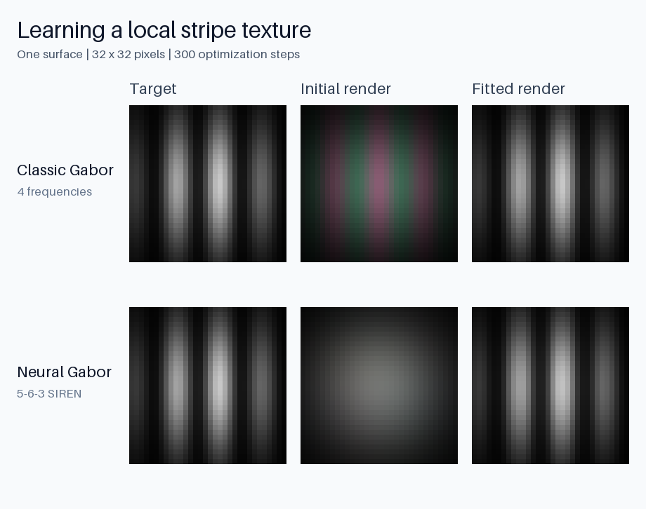

# Gabor Splatting

One PyTorch/CUDA package for classic four-frequency Gabor surfaces and neural
Gabor surfaces with per-primitive SIRENs. Both renderers support fused batches of
independent scenes and multiple cameras, visible-pair packing, and first-order
gradients for RGB, alpha, depth, normals, and distortion.

These are oriented **2D surfaces in 3D**, following the upstream Gabor methods.
Appearance is evaluated at ray–surface intersections with the upstream low-pass
filter. Fused scene/camera batching is inspired by
[gsplat](https://docs.gsplat.studio/main/). See [contracts](docs/contracts.md)
and [attribution](NOTICE.md).
The inherited [license](LICENSE.md) limits use to non-commercial research and evaluation.



Synthetic appearance fitting on one fixed surface: both methods learn the same
alpha-weighted stripe target. Each 32×32 render is enlarged with nearest-neighbor
sampling. Reproduce this image with the command in [Examples and benchmark](#examples-and-benchmark).

The distribution is named `gabor-splatting` and imported as `gabor_splatting`.
Both rendering methods are installed together in one CUDA extension.

## Release notes

### v0.1.1

- Shared-memory primitive batches in forward and backward, with warp-reduced
  geometry, opacity, appearance, and background gradients.
- Fused CUDA evaluation/backward for both classic SH colors, including camera
  direction gradients.
- `validate=False` skips numerical value checks on trusted inputs while retaining
  shape, dtype, device, and layout checks. The default remains `validate=True`.
- The [synthetic benchmark](benchmarks/benchmark_rasterization.py) reports latency
  and optional CUDA kernel times for configurable Gabor workloads. See [performance validation](docs/performance.md).

## Requirements

- Linux and Python 3.10 or newer, with Python development headers.
- An NVIDIA GPU and a CUDA toolkit containing `nvcc`.
- CUDA-enabled PyTorch and a compatible C++ compiler.

Installation compiles the extension against PyTorch. Rendering uses CUDA float32;
there is no compilation on import. See [validated configurations](docs/validation.md)
for the tested Python, Torch, toolkit, and GPU combination.

## Installation

### From Git in a uv project

Add the tagged Git dependency to your project's `pyproject.toml`:

```toml
[project]
dependencies = [
  "torch==2.8.*",
  "gabor-splatting @ git+https://github.com/luisrodolfo10/diff_gabor_splatting.git@v0.1.1",
]

[tool.uv.extra-build-dependencies]
gabor-splatting = [{ requirement = "torch", match-runtime = true }]
```

Then install:

```bash
uv sync
```

The per-package build setting compiles against the same Torch version used at
runtime. Select a CUDA-enabled Torch build compatible with your toolkit; a
complete CUDA-index configuration is in the [installation guide](docs/installation.md).

### From a checkout

```bash
git clone https://github.com/luisrodolfo10/diff_gabor_splatting.git
cd diff_gabor_splatting
uv sync
```

The checkout configures the tested Torch 2.8/cu128 runtime and matching build
requirements. For development tools and PNG export, use `uv sync --all-extras`.
Run examples and checks with `uv run`.

### Build configuration

Set these only when needed for your toolkit, GPU, or compiler resources:

```bash
CUDA_HOME=/usr/local/cuda TORCH_CUDA_ARCH_LIST="8.6" MAX_JOBS=4 uv sync
```

Installation compiles the extension once; rendering does not compile code on
import. See [installation details](docs/installation.md) for prerequisites and
rebuilding after a Torch/CUDA upgrade.

## Rendering

```python
import torch
from gabor_splatting import rasterize_gabors, rasterize_neural_gabors

means = torch.tensor([[0.0, 0.0, 3.0]], device="cuda")
quaternions = torch.tensor([[1.0, 0.0, 0.0, 0.0]], device="cuda")
scales = torch.tensor([[0.4, 0.4]], device="cuda")
opacities = torch.tensor([0.8], device="cuda")
view_matrices = torch.eye(4, device="cuda")[None]
intrinsics = torch.tensor([[[80.0, 0.0, 32.0], [0.0, 80.0, 32.0], [0.0, 0.0, 1.0]]], device="cuda")

rgb, alpha, meta = rasterize_gabors(
    means,
    quaternions,
    scales,
    opacities,
    colors=torch.tensor([[1.0, 0.2, 0.1]], device="cuda"),
    secondary_colors=torch.tensor([[0.1, 0.2, 1.0]], device="cuda"),
    frequency_weights=torch.full((1, 4), 0.25, device="cuda"),
    frequency_magnitudes=torch.full((1, 4), 2.0, device="cuda"),
    phases=torch.zeros(1, 4, device="cuda"),
    view_matrices=view_matrices,
    intrinsics=intrinsics,
    width=64,
    height=64,
)
# rgb: [1, 64, 64, 3]; alpha: [1, 64, 64, 1]

rgb, alpha, meta = rasterize_neural_gabors(
    means,
    quaternions,
    scales,
    opacities,
    input_weights=torch.empty(1, 6, 5, device="cuda").uniform_(-1 / 5, 1 / 5),
    input_biases=torch.zeros(1, 6, device="cuda"),
    output_weights=torch.empty(1, 3, 6, device="cuda").uniform_(-1 / 30, 1 / 30),
    output_biases=torch.zeros(1, 3, device="cuda"),
    view_matrices=view_matrices,
    intrinsics=intrinsics,
    width=64,
    height=64,
)
```

For scene batches, use means `[B, N, 3]`, surface scales `[B, N, 2]`, and cameras
`[B, C, 4, 4]`. Arbitrary matching leading scene dimensions are supported.
Outputs are `[B, C, H, W, channels]`. `packed=True` compacts visible projected
pairs before binning. Both modes use one image-aware sort and tile launch,
without Python loops over scenes or cameras.

Classic colors can be real SH coefficients with `sh_degree=0..3`. Neural colors
are computed at each surface intersection; weights are shared across cameras
viewing the same scene. All input tensors must be contiguous CUDA float32.

```python
loss = rgb.mean() + alpha.mean() + 0.01 * meta["distortion"].mean()
loss.backward()  # when input parameters require gradients
```

## How rendering works

Both methods use oriented 2D Gaussian surfaces in 3D. Each pixel ray intersects a
surface to obtain its scaled tangent coordinates. The renderer applies the
Gaussian envelope and screen-space low-pass filter, evaluates the appearance at
that intersection, and composites contributions front to back.

- **Classic Gabor:** four fixed frequency directions blend two colors. Each
  primitive has learnable frequency weights, magnitudes, and phases. Colors can
  instead be spherical harmonics with `sh_degree=0..3`.
- **Neural Gabor:** a separate 5→6→3 SIREN per primitive takes two surface
  coordinates and three world-space view-direction components, and predicts RGB.
  Network weights are shared across cameras viewing the same scene.

Both functions return RGB, alpha, and metadata containing accumulated depth,
weighted camera-space normals, distortion, radii, and projected means. Expected
depth can be obtained by dividing accumulated depth by alpha on nonempty pixels.
All continuous image maps support first-order reverse-mode gradients; culling,
sorting, and tile membership are discrete. Full definitions are in the
[rendering contracts](docs/contracts.md).

### Fused scene and camera batches

Leading dimensions represent independent scenes, `N` is the number of primitives
per scene, and `C` is the number of cameras sharing each scene. For example,
`means` is `[B, N, 3]`, `quaternions` is `[B, N, 4]`, `scales` is `[B, N, 2]`,
`view_matrices` is `[B, C, 4, 4]`, and `intrinsics` is `[B, C, 3, 3]`. All leading
scene dimensions must match; arbitrary matching leading dimensions are supported.

Following the batching design popularized by
[gsplat](https://docs.gsplat.studio/main/), all scene/camera pairs are projected
together. The renderer assigns image IDs, emits image-aware tile/depth keys,
sorts them in one CUDA operation, and composites all images in one tile launch.
Backward accumulates contributions into parameters shared by multiple views.
There is no Python loop over scenes or cameras in either rendering function.

`packed=False` retains all projected pairs and is the default. `packed=True`
compacts visible pairs before tile binning. Both return the same dense image
shapes: RGB `[..., C, H, W, 3]` and alpha `[..., C, H, W, 1]`. Packed metadata
contains aligned scene, camera, and primitive IDs. Projection is still dense
before compaction, so packing reduces binning/compositor storage rather than the
initial projection graph. Its speed benefit depends on visibility and workload.

### Differences from the upstream research implementations

This package exposes two tensor-based functions with a common scene/camera
contract and named outputs. It adds fused batching and visible-pair packing while
retaining each method's surface and appearance equations. Classic Gabor and
neural Gabor keep their respective low-pass depth conventions, as documented in
the [contracts](docs/contracts.md#geometry-and-cameras).

The interface uses contiguous CUDA float32 tensors, unit wxyz quaternions,
positive two-axis scales, activated opacities, world-to-camera matrices, and
pixel-space intrinsics. It is a rendering library; the upstream training systems,
COLMAP loading, densification, and mesh extraction remain separate. The gsplat
reference describes batching inspiration; gsplat is not a runtime dependency,
and these functions have their own Gabor-specific arguments.

### Trusted training inputs

Both public renderers accept `validate=False` to skip numerical value checks
once the caller guarantees the documented contracts. Structural checks remain
active. This removes the value-check reductions and their synchronization; the
variable-size tile-allocation synchronization remains. Projection stays in
PyTorch. See [contracts](docs/contracts.md#differentiability-and-execution).

## Examples and benchmark

```bash
uv run python examples/fit_texture.py --method classic --steps 100
uv run python examples/fit_texture.py --method neural --steps 100
uv run python benchmarks/benchmark_rasterization.py --method both --output-json results.json
uv run python benchmarks/benchmark_rasterization.py --num-scenes 2 --num-cameras 4 --num-primitives 1000
```

To regenerate the comparison image above, install the optional image-export
extra and run both fits with the fixed example seed:

```bash
uv sync --extra examples
uv run python examples/fit_texture.py --method both --steps 300 --output assets/texture-fitting.png
```

The benchmark compares `single_view_loop`, `fused_dense`, and `fused_packed`.
It checks image and parameter-gradient parity before timing. It reports forward,
backward, combined latency, throughput, peak allocated CUDA memory, and speedup
relative to the loop within each method. Scene creation and IO are excluded.
The default is 10,000 primitives, one scene, four cameras, and 256×256 images.

To include a separate CUDA kernel profile and skip numerical input checks:

```bash
uv run python benchmarks/benchmark_rasterization.py --method both --profile-iterations 5 --skip-validation --output-json profile.json
```

All inputs are generated deterministically from the seed; no dataset or model
files are needed. See the [performance guide](docs/performance.md) for measurement
details and recorded results.

## Validation

```bash
uv sync --extra dev
uv run ruff check .
uv run ruff format --check .
uv run pytest
uv build
```

CUDA numerical checks require an actual GPU. Full reconstruction training,
densification, mesh extraction, median depth, ragged scene batches, selected-pixel
rendering, and arbitrary neural architectures are outside this release.

## References

The two appearance models follow:

- **3D Gabor Splatting: Reconstruction of High-frequency Surface Texture using Gabor Noise.**
  Haato Watanabe, Kenji Tojo, and Nobuyuki Umetani. Eurographics Short Papers, 2025.
  [Paper](https://arxiv.org/abs/2504.11003) ·
  [Project](https://haato-w.github.io/3d-gabor-splatting-project-page/) ·
  [Training code](https://github.com/haato-w/3d-gabor-splatting) ·
  [CUDA rasterizer](https://github.com/haato-w/diff-gabor-rasterization).
- **Neural Gabor Splatting: Enhanced Gaussian Splatting with Neural Gabor for High-frequency Surface Reconstruction.**
  Haato Watanabe and Nobuyuki Umetani. CVPR, 2026.
  [Paper](https://arxiv.org/abs/2604.15941) ·
  [Project](https://haatowatanabe.com/projects/neural-gabor-splatting/) ·
  [Training code](https://github.com/haato-w/neural-gabor-splatting) ·
  [CUDA rasterizer](https://github.com/haato-w/diff-neural-gabor-rasterization).

Surface projection and compositing build on
[2D Gaussian Splatting for Geometrically Accurate Radiance Fields](https://surfsplatting.github.io/)
(Huang et al., SIGGRAPH 2024) and
[3D Gaussian Splatting for Real-Time Radiance Field Rendering](https://repo-sam.inria.fr/fungraph/3d-gaussian-splatting/)
(Kerbl et al., SIGGRAPH 2023).

Fused scene/camera batching is inspired by **gsplat: An open-source library for
Gaussian splatting** (Ye et al., JMLR 2025).
[Paper](https://www.jmlr.org/papers/v26/24-1476.html) ·
[Documentation](https://docs.gsplat.studio/main/) ·
[Code](https://github.com/nerfstudio-project/gsplat).

BibTeX entries are available in [references.bib](references.bib). See
[NOTICE.md](NOTICE.md) for the pinned upstream rasterizer commits and source attribution.
